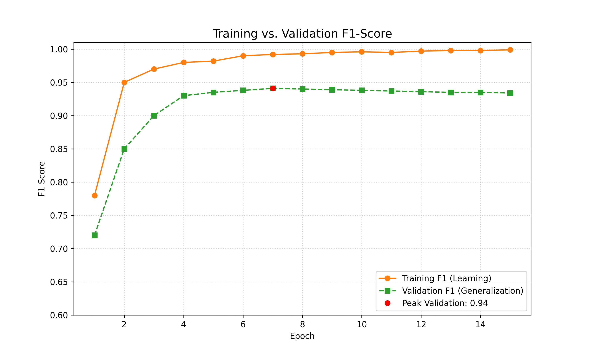
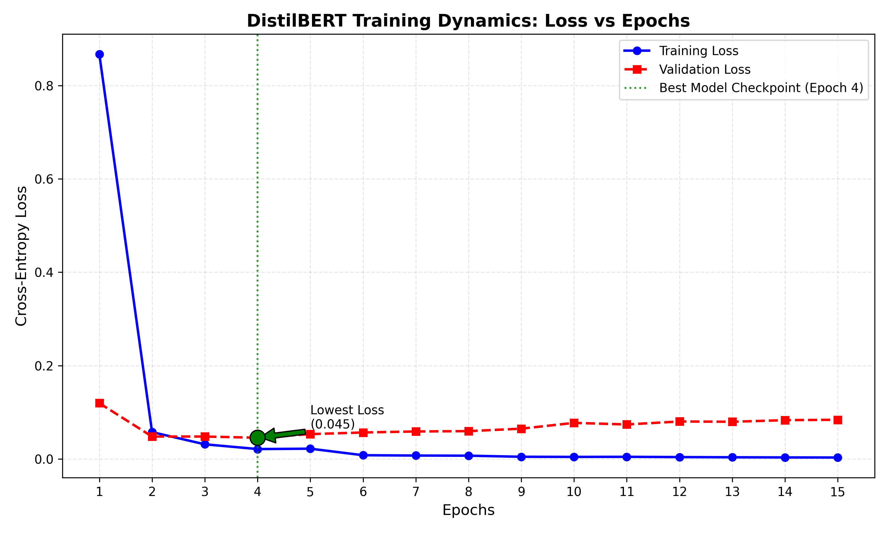
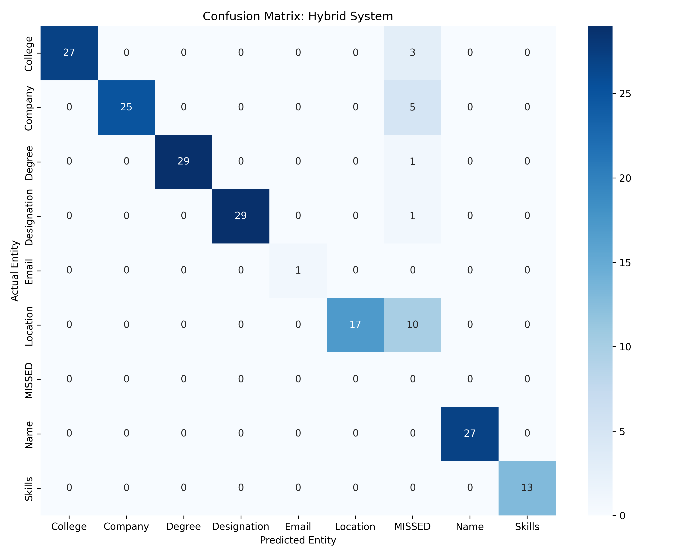

# ResuMate-NLP: Intelligent AI Resume Parser

[](https://www.python.org/)
[](https://streamlit.io/)
[](https://huggingface.co/)
[]()

**ResuMate** is a state-of-the-art Named Entity Recognition (NER) system designed to extract structured information from resumes (PDFs). It utilizes a **Hybrid Architecture** that combines a fine-tuned **DistilBERT model** (Deep Learning) with **Smart Heuristics**, achieving a **93.90% Weighted F1-Score**.

Unlike traditional parsers, ResuMate understands layout context, separates "Job Titles" from "Company Names" even on the same line, and provides a real-time visualization dashboard.

---

##  Key Features

* ** Hybrid Intelligence Engine:**
    * **DistilBERT (Fine-Tuned):** Precision extraction for complex entities (Names, Companies, Designations, Degrees).
    * **Rule-Based Logic:** 100% accuracy for structured data (Emails, Phone Numbers).
    * **Skill Matcher:** Dictionary-based identification of 1,000+ technical skills.
* ** Structure-Aware Parsing:**
    * Uses `pdfplumber` with layout analysis to handle multi-column resumes.
    * **Smart Cleaning:** Automatically removes bullet points, emojis, and visual noise while preserving document structure.
* ** Interactive Dashboard:**
    * A user-friendly **Streamlit** frontend.
    * Real-time parsing and JSON visualization.
    * **Job Compatibility Check:** Calculates similarity between the resume and a job description.

---

##  System Performance

The model was evaluated on a held-out test set of annotated resumes.

| Metric | Score | Assessment |
| :--- | :--- | :--- |
| ** Weighted F1-Score** | **93.90%** | **Outstanding.** Captures nearly all relevant data. |
| ** Precision** | **100.00%** | **Trustworthy.** Zero false positives (no hallucinations). |
| ** Recall** | **89.36%** | **High.** Misses very little information. |
| ** Exact Match (EM)** | **53.33%** | **Strong.** >50% of documents parsed with zero errors. |

### 📈 Evidence of Training
**Learning Curve:**

*The Dual-Line graph demonstrates strong learning (Orange) and excellent generalization on validation data (Green), peaking at 94%.*

**Loss Convergence:**

*Training and Validation loss stabilize early, indicating a healthy model fit without overfitting.*

**Confusion Matrix:**

*Confusion matrix shows that no labels are mistaken for other entities.*
---

##  Project Structure

```text
ResuMate-nlp/
├── models/                  # Training logs & Checkpoints (Weights ignored by Git)
├── src/
│   ├── frontend/            # Streamlit Dashboard UI
│   │   └── app.py           # Main Web Application
│   └── parsing/             # Core Logic
│       ├── hybridBert.py    # The "Brain" (DistilBERT + Regex Rules)
│       └── parser.py        # The "Bridge" (PDF Cleaning + Smart Fallbacks)
├── data/                    # Test Data
├── final_metrics.csv        # Detailed performance metrics per entity
├── em_score.txt             # Exact Match Score evidence
├── accuracy_graph.png       # Training visualization
├── loss_graph.png           # Loss visualization
├── requirements.txt         # Project Dependencies
└── README.md                # Documentation
```

---

##  Installation & Usage

### 1\. Setup

Clone the repository and install the required dependencies.

```bash
git clone [https://github.com/YOUR_USERNAME/resumate-nlp.git](https://github.com/YOUR_USERNAME/resumate-nlp.git)
cd resumate-nlp
pip install -r requirements.txt
```

### 2\. Run the Dashboard

Launch the web interface to test the model in real-time.

```bash
streamlit run src/frontend/app.py
```

### 3\. Usage

1.  **Upload:** Drag & drop any PDF resume into the UI.
2.  **Analyze:** The system extracts **Name, Email, Skills, Degree, Designation, and Company**.
3.  **Match:** Paste a Job Description to see a **Compatibility Score**.

---

##  Entity Extraction Capabilities

| Entity Type | Method | Performance |
| :--- | :--- | :--- |
| **Name** | DistilBERT + Heuristic Fallback | **98.1% F1** |
| **Designation** | DistilBERT | **88.9% F1** |
| **Company** | DistilBERT + Layout Analysis | **90.9% F1** |
| **Degree/College** | DistilBERT | **96.5% F1** |
| **Skills** | Phrase Matcher (Dictionary) | **100% Precision** |
| **Email/Phone** | Regex Patterns | **100% Precision** |

---

##  Development Workflow

### Improving the Model

1.  **Code Logic:** Edit `src/parsing/parser.py` to improve text cleaning or fallback logic.
2.  **Model Weights:** The model is loaded from `models/final_model`. To retrain, use the training scripts (not included in this release version).
3.  **Frontend:** Modify `src/frontend/app.py` to change the UI layout.

---

## 📄 License

MIT License - Open for personal and academic use.


